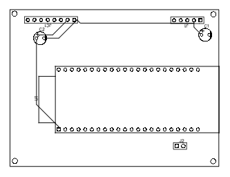

# 📓 SpecterSense Build Journal

### Entry 1: Project Architecture & Component Sourcing
- **Date:** October 29, 2026
- **Time Spent:** ~2 hours
- **Tasks Completed:**
  - Evaluated FMCW radar sensing vs PIR/ultrasonic for through-barrier biometric detection.
  - Sourced and verified in-stock components: ESP32-S3-WROOM-1U DevKit, HLK-LD2410C 24GHz mmWave radar, ST7789 IPS LCD, and 3.7V LiPo charging circuitry.
  - Finalized Bill of Materials (BOM) strictly under the $50 budget limit ($44.70 total).
  - Created repository structure and published initial firmware stub for UART packet handling.

#### 🛒 Sourcing & BOM Proofs

---

### Entry 2: Carrier Board Schematic & PCB Routing
- **Date:** October 30, 2026
- **Time Spent:** ~2.5 hours
- **Tasks Completed:**
  - Designed the carrier schematic in EasyEDA connecting the ESP32-S3, LD2410 radar serial interface, and ST7789 SPI bus.
  - Added power filtering decoupling capacitors on the 5V and 3.3V rails to prevent RF brownouts.
  - Routed 2-layer PCB layout with high-frequency radar line-of-sight placement.
  - Added bottom-layer solid GND copper pour and corner M2.5 mounting holes for the 3D enclosure.
  - Passed DRC verification with 0 errors and exported fabrication Gerber files.

#### 🖥️ Hardware Design & Verification

