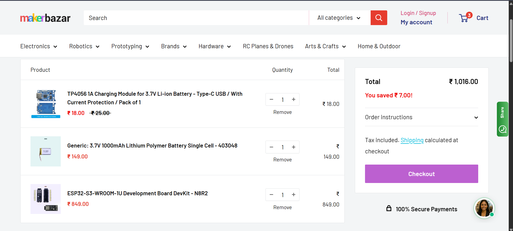
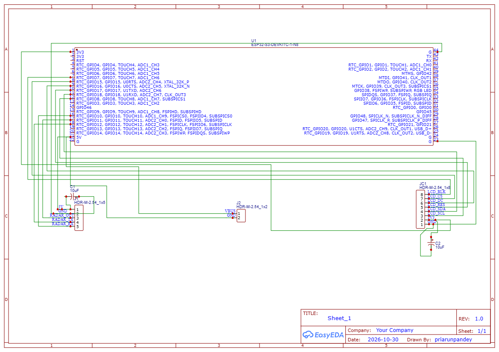
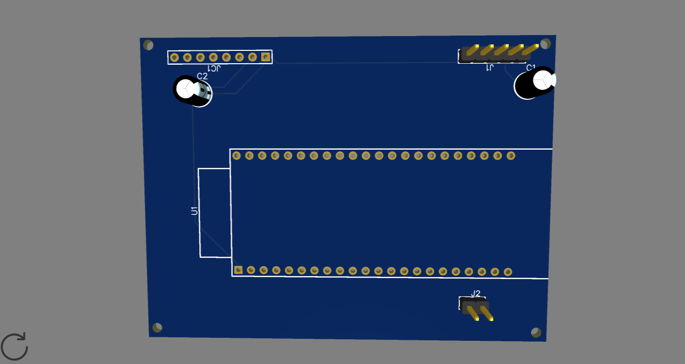

# 📡 SpecterSense: ESP32-S3 Through-Wall mmWave Biometric Radar

> A handheld, standalone biometric radar scanner powered by an ESP32-S3 and a 24 GHz FMCW radar sensor to detect human presence, micro-movement, and respiration through non-metallic barriers.

---

## 💡 Overview

**SpecterSense** is a dedicated, portable embedded hardware instrument built from the ground up on a custom carrier PCB. 

Unlike systems relying on bulky, off-the-shelf Linux single-board computers, SpecterSense is an **authentic embedded hardware project**. It couples high-frequency RF sensing with an ESP32-S3 dual-core microcontroller to perform on-device serial parsing and visual radar mapping on a 1.69" IPS display, all housed in a pocket-sized 3D-printed enclosure.

### Key Capabilities
- **Through-Wall Sensing:** Detects human targets through interior drywall, plywood, glass, and doors using 24 GHz FMCW millimeter waves.
- **Micro-Motion & Breathing Tracking:** Captures subtle sub-millimeter chest wall movements (respiration) even when the person is sitting or standing still.
- **Hardware Radar Scope Display:** Drives an ST7789 IPS LCD at 240×280 over high-speed SPI to display real-time radial sweeps, distance gates (0.75 m – 6.0 m), and target energy levels.
- **Self-Contained Power Management:** Powered by an internal 3.7V 1000mAh LiPo battery with integrated Type-C charging, low-dropout regulation, and safe discharge protection.

---

## 🛠️ Hardware Architecture & System Design
### Pinout & Interfacing

| Subsystem | Peripheral Pin | ESP32-S3 Pin | Description |
| :--- | :--- | :--- | :--- |
| **Radar (HLK-LD2410C)** | TX | GPIO 18 (RX1) | Radar UART packet stream input |
| | RX | GPIO 17 (TX1) | Radar threshold configuration commands |
| | VCC / GND | 5V / GND | Power rail with filtering decoupling caps |
| **Display (ST7789 SPI)** | SCL / SCK | GPIO 12 | Hardware SPI Clock |
| | SDA / MOSI | GPIO 11 | Hardware SPI Data Out |
| | RES / RST | GPIO 10 | Display Hardware Reset |
| | DC | GPIO 9 | Data / Command Control |
| | CS | GPIO 8 | Chip Select (Active Low) |
| | BLK / Backlight | GPIO 7 | PWM Backlight Dimming |
| **Power System** | VBUS / BAT+ | 5V / 3.3V Rails | TP4056 1A LiPo charging via USB-C |

---

## 🧾 Bill of Materials (BOM)

| Item | Component / Description | Qty | Price (INR) | Price (USD) | Source / Vendor |
| :---: | :--- | :---: | :---: | :---: | :--- |
| **1** | ESP32-S3-WROOM-1U DevKit (N8R2) | 1 | ₹849.00 | $10.05 | [MakerBazar](https://makerbazar.in) |
| **2** | 3.7V 1000mAh LiPo Battery Single Cell (403048) | 1 | ₹149.00 | $1.76 | [MakerBazar](https://makerbazar.in) |
| **3** | TP4056 1A Li-ion Type-C Charger Module w/ Protection | 1 | ₹18.00 | $0.21 | [MakerBazar](https://makerbazar.in) |
| **4** | Hi-Link HLK-LD2410C-P 24GHz mmWave Human Presence Radar | 1 | ₹529.00 | $6.26 | [Robu.in](https://robu.in) |
| **5** | 1.69" 240×280 SPI IPS LCD Display Module (ST7789) | 1 | ₹459.00 | $5.43 | [Robu.in](https://robu.in) |
| **6** | Custom 2-Layer Carrier PCB (5 pcs + standard shipping) | 1 set | ₹1,260.00 | $15.00 | [JLCPCB](https://jlcpcb.com) |
| **7** | Custom 3D Printed Handheld Case (Resin/SLA) & Fasteners | 1 set | ₹508.00 | $6.00 | JLC3DP / Robu 3D |
| **Total** | | | **₹3,772.00** | **~$44.70** | |

*(Exchange rate estimated at ₹84.50 / $1 USD)*

---

## 🛒 Quotation & Component In-Stock Proof

#### MakerBazar Cart (ESP32-S3, LiPo Battery & Charger)

#### Robu.in Cart (24GHz mmWave Radar & 1.69" ST7789 LCD)

### 🖥️ PCB Layout & 3D Render

---

## 🚀 Build & Firmware Plan

1. **Hardware Validation:** Connect the HLK-LD2410C sensor over UART to confirm gate-energy data packets in engineering mode.
2. **PCB Layout:** Design a 2-layer carrier PCB in EasyEDA incorporating the ESP32-S3 socket, ST7789 header, level regulation, and TP4056 battery inputs.
3. **Firmware Implementation:** Written in C++ (ESP-IDF / Arduino Framework) utilizing `TFT_eSPI` for high-refresh rendering and asynchronous UART stream decoding.
4. **Mechanical Assembly:** Design and 3D print a snap-fit enclosure leaving a front opening for the display and an unobstructed front RF window for the radar.

---

## 📜 License
This project is open-source under the MIT License.
